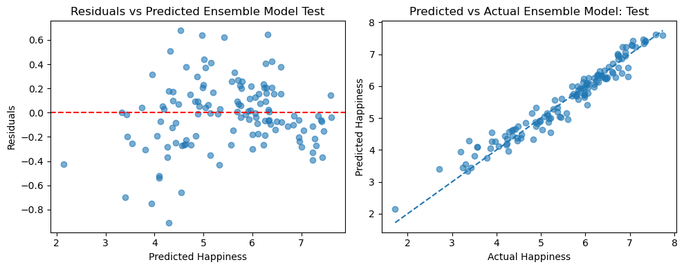

# Predicting Country-Level Life Evaluation with Machine Learning

Graduate capstone project, M.S. Data Science, DePaul University (Spring 2026).

This project predicts country-level **life evaluation** (the World Happiness Report's "ladder" score, 0-10) from a broad set of socioeconomic and development indicators. It merges three public data sources into one country-year dataset, compares nine regression models plus a stacked ensemble, and uses LASSO to cut about 500 indicators down to 64 without losing accuracy.

**Headline result:** a stacked Gradient Boosting + XGBoost ensemble reached a test **R² of 0.946 (RMSE 0.277)** on a held-out year (2023, 128 countries), using 64 selected features. See [Limitations](#limitations) for what that number does and does not show.

Full write-up: [`Capstone Report.pdf`](Capstone Report.pdf)



## Data

| Source | What it provides |
|---|---|
| [World Happiness Report 2025](https://worldhappiness.report/data-sharing/) (Data for Figure 2.1) | Target variable: `Life evaluation (3-year average)`, by country and year |
| [World Bank DataBank](https://databank.worldbank.org/) | Hundreds of development indicators (health, infrastructure, trade, economy, labor, demographics) |
| [UNDP Human Development Reports](https://hdr.undp.org/data-center) | Human Development Index and related indicators |

After merging and cleaning, the modeling dataset has about 1,566 country-year rows (2011-2023) and 502 candidate features.

## Pipeline

**1. Preprocessing (`01_preprocessing.ipynb`)**
- Standardize country names across the three sources so they join correctly.
- Merge on country and year; drop 2024 and six territories that do not appear in all sources.
- Drop columns with more than 30% missing values, and country-years with no World Bank data.
- Fill remaining gaps with the **nearest available year for the same country** (ties go to the later year), falling back to the global column mean.
- Export `Finalized_MasterList.csv`.

**2. Modeling (`02_modeling.ipynb`)**
- Remove 13 duplicate or near-duplicate columns (for example, several labor-force and life-expectancy variants).
- Exploratory analysis: correlations with life evaluation, scatterplots, and feature distributions.
- **Time-based split:** train on 2011-2022 (1,438 rows), test on 2023 (128 countries).
- Train nine models on the **full feature set** (502 features): Multiple Linear Regression, Ridge, LASSO, SVR, Decision Tree, Random Forest, AdaBoost, Gradient Boosting, XGBoost.
- **Feature selection:** LASSO (cross-validated, fit on training data only) keeps 64 features. Five skewed features were log-transformed after inspecting scatterplots.
- Retrain all models on the **reduced 64-feature set**, tuning Gradient Boosting, Random Forest, and XGBoost with cross-validated searches.
- Build a **stacked ensemble** of the tuned Gradient Boosting and XGBoost models.
- Interpret the ensemble with permutation importance on the test set.

## Results

Test set: 2023, 128 countries. Lower RMSE and higher R² are better.

**Full feature set (502 features)**

| Model | Test RMSE | Test R² |
|---|---|---|
| XGBoost | 0.279 | 0.945 |
| Random Forest | 0.319 | 0.928 |
| Gradient Boosting | 0.326 | 0.924 |
| SVR | 0.380 | 0.897 |
| AdaBoost | 0.406 | 0.883 |
| Decision Tree | 0.439 | 0.863 |
| Ridge | 0.450 | 0.856 |
| LASSO | 0.451 | 0.855 |
| Multiple Linear Regression* | 0.571 | 0.768 |

\*The linear regression baseline in the notebook uses the 58 features with an absolute correlation above 0.7 with the target (computed on pre-2023 data), not all 502, to avoid overfitting.

**Reduced feature set (64 features)**

| Model | Test RMSE | Test R² |
|---|---|---|
| **Stacked ensemble (GBR + XGBoost)** | **0.277** | **0.946** |
| Gradient Boosting | 0.282 | 0.944 |
| XGBoost | 0.284 | 0.943 |
| Random Forest | 0.327 | 0.924 |
| SVR | 0.398 | 0.887 |
| Decision Tree | 0.429 | 0.869 |
| LASSO | 0.433 | 0.867 |
| Ridge | 0.450 | 0.856 |
| AdaBoost | 0.465 | 0.846 |
| Multiple Linear Regression | 0.486 | 0.832 |

**What stands out**
- Tree-based boosting models clearly beat linear models, which suggests nonlinear relationships between development indicators and life evaluation.
- Cutting from 502 to 64 features cost almost nothing, and Gradient Boosting improved (test RMSE 0.326 to 0.282).
- The ensemble's edge over the best single model is small (0.277 vs 0.282 RMSE).
- **Top drivers (permutation importance, ensemble):** GNI per capita (Atlas method) by a wide margin, followed by government health expenditure, access to electricity, consumer price index, reproductive/maternal health service coverage, and access to clean cooking fuels.

## Limitations

- **The test set is the same countries one year later.** Every 2023 country also appears in the training years, and the target is a 3-year average, so adjacent years overlap. The scores reflect predicting known countries forward in time, not generalizing to countries the model has never seen.
- **Cross-validation hints at lower accuracy on new countries.** The data is sorted by country and the search used unshuffled 5-fold splits, so folds are largely blocks of different countries. The cross-validated RMSE for the final Gradient Boosting model was about 0.49, compared with 0.28 on the 2023 test set.
- **Imputation was done before the train/test split.** Nearest-year filling and global means used the full dataset, so a small amount of information from 2023 may have reached training rows.
- **One test year and no confidence intervals.** Differences of a few thousandths of RMSE between top models are likely within noise.
- **Importance is not causation.** Many World Bank indicators are highly collinear (several GNI and GDP variants, for example), so importance is split among related features.
- **Comparisons to published results are approximate.** Prior studies used different data, features, and splits.

## Reproducing the results

The data files are not included in this repository. To run the notebooks:

1. Download the three sources listed above and place the files in the project folder using these names:
   - `WHR25_Data_Figure_2.1v3.csv`: WHR 2025 Data for Figure 2.1.
   - `updatedData.csv`: World Bank DataBank export with one row per country-year and one column per indicator, missing values shown as `..`. [Add the database and series selection used.]
   - `HDI_Data_Pivoted.csv`: UNDP data reshaped to one row per country-year. [Add which indicators and how the file was pivoted.]
2. Run `01_preprocessing.ipynb` to produce `Finalized_MasterList.csv`.
3. Run `02_modeling.ipynb`.

Results can differ slightly if newer versions of the source data are used.

## Setup

```bash
python -m venv .venv
source .venv/bin/activate        # Windows: .venv\Scripts\activate
pip install -r requirements.txt
jupyter notebook
```

Developed with Python 3.12. `pandas` is pinned below 3.0 because the preprocessing notebook uses `pd.to_numeric(errors="ignore")`, which newer versions remove.

## Repository contents

| Path | Description |
|---|---|
| `01_preprocessing.ipynb` | Merging, cleaning, and imputation |
| `02_modeling.ipynb` | EDA, feature selection, modeling, tuning, ensemble, interpretation |
| `report/Capstone_Report.pdf` | Written report |
| `figures/` | Figures used in this README |
| `requirements.txt` | Python dependencies |

## Tools

Python, pandas, NumPy, scikit-learn, XGBoost, matplotlib, seaborn.

## Author

Nick Bray, M.S. Data Science (Computational Methods), DePaul University.
